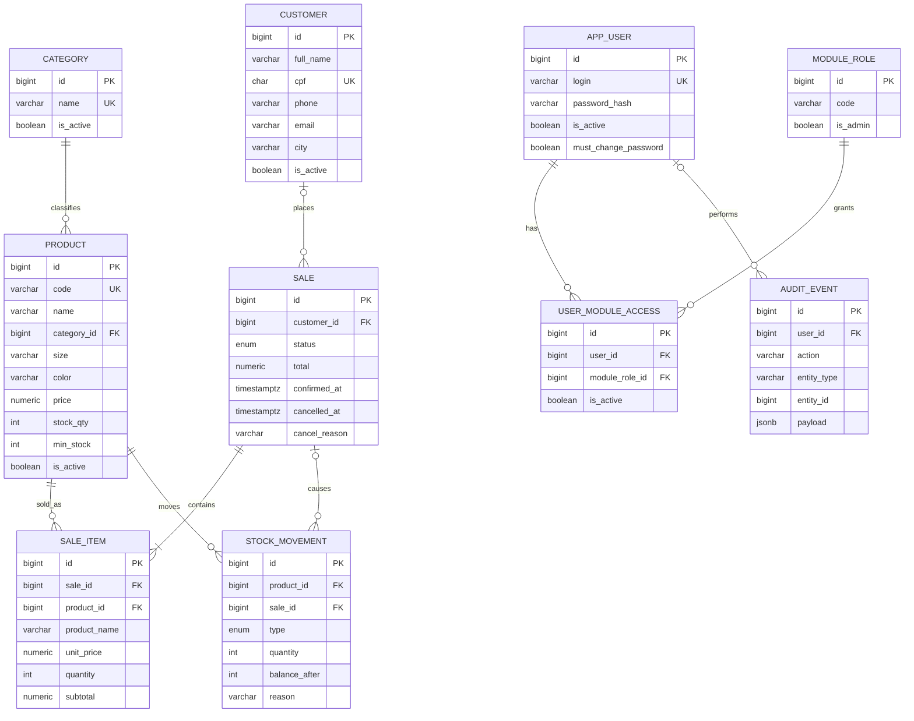

# CRM Loja de Roupas — Documentação do MVP

Oct 26, 2026 · @Douglas Vargas

## 1. Visão geral

O MVP é uma aplicação web em Java (Spring Boot) com front em React e banco PostgreSQL, seguindo uma arquitetura de monólito modular (migrations versionadas, testes contra banco real). Ele centraliza clientes, produtos, categorias, estoque e vendas de uma loja de roupas, e tem um dashboard que lê os dados reais do banco.

**Problema:** sem sistema integrado, a loja não sabe o que tem disponível, perde o histórico de compras dos clientes e não enxerga o resultado das vendas.

**Objetivo do MVP:** cobrir o ciclo completo cadastro → entrada em estoque → venda → baixa automática → cancelamento com estorno → indicadores, sempre mantendo estoque e histórico coerentes.

### Módulos

| Módulo | O que entrega |
| --- | --- |
| Clientes | CRUD, busca por nome/CPF, histórico de compras |
| Categorias | CRUD, bloqueio de exclusão com produtos vinculados |
| Produtos | CRUD, filtros por nome/categoria/tamanho/código/disponibilidade, ativo × indisponível |
| Estoque | Saldo, entradas, ajustes, histórico de movimentações, estoque baixo/zerado |
| Vendas | Carrinho com cálculo automático, confirmação com baixa, cancelamento com estorno, consulta por número/cliente/data/status |
| Dashboard | Totais, vendas e faturamento por período, mais vendidos, estoque baixo e zerado |
| Acesso | Login, troca de senha, 3 perfis (Gerente, Vendedor, Estoquista), auditoria das operações sensíveis |

### Fora do escopo do MVP

- Escopo por loja ou região (o sistema atende uma única loja)
- Variações de produto (tamanho/cor como tabela própria): cada combinação é um produto com código próprio
- Descontos, formas de pagamento, nota fiscal, troca/devolução parcial
- Integração com sistemas externos

Esses itens só entram depois que todos os critérios obrigatórios estiverem aprovados.

## 2. Stack e arquitetura

O projeto usa Java/Spring Boot no back-end. É um **monólito modular**: um núcleo (`core`: acesso, permissões, auditoria) e um módulo de negócio (`crm`). O módulo depende do núcleo, nunca o contrário.

| Camada | Tecnologia | Papel |
| --- | --- | --- |
| Back-end | Java 21 + Spring Boot 3 (Web, Data JPA, Validation, Security) | API REST, regras, transações |
| Banco | PostgreSQL 16 | Persistência, CHECKs, triggers |
| Migrations | Flyway (SQL versionado) | Único caminho para mudar o schema; `ddl-auto=validate` |
| Autenticação | Spring Security + JWT (jjwt) em cookie httpOnly | Access 10 min, refresh rotativo 24 h |
| Testes | JUnit 5 + MockMvc + Testcontainers (Postgres real) | Integração contra banco de verdade |
| Front-end | React 19 + Vite + TypeScript estrito | SPA |
| Estado de servidor | TanStack Query 5 | Cache, invalidação após mutações |
| Estilo | Tailwind CSS 4 + tokens CSS | Tema claro/escuro por variáveis |
| Build | Maven Wrapper (`./mvnw`) · pnpm no front | Nada de npm/yarn |
| Local | Docker Compose com `postgres:16` | Mesmo banco do CI |
| CI | GitHub Actions com serviço Postgres | lint, testes e build em todo PR |

### Padrões de arquitetura aplicados em Java

| Padrão | No CRM em Spring Boot |
| --- | --- |
| Composition root em `main.ts` | `CrmApplication` + classes `@Configuration`; só elas ligam núcleo e módulo |
| Config fail-fast (`env.ts`) | `@ConfigurationProperties` + `@Validated`: sem `JWT_SECRET` a aplicação não sobe |
| Migrations TypeORM com `down()` | Flyway `V{n}__*.sql` + script de reversão `U{n}__*.sql` documentado; expand/contract |
| `synchronize: false` | `spring.jpa.hibernate.ddl-auto=validate` |
| PK `bigint identity`, `is_active` booleano | Igual: `GENERATED ALWAYS AS IDENTITY`, nada de soft-delete |
| Erros de domínio → 400/404/409 | Exceções de domínio + `@RestControllerAdvice` devolvendo `{error, code}` |
| `dataSource.transaction` + `pessimistic_write` | `@Transactional` + `@Lock(PESSIMISTIC_WRITE)` |
| Congelar valor da época | `sale_item` copia código, nome e preço do produto |
| Log imutável por trigger | `stock_movement` e `audit_event` recusam UPDATE/DELETE no banco |
| Seed reconciliador no boot | `ApplicationRunner` idempotente para módulo, papéis e super admin |
| Testes Vitest + Supertest em Postgres real | JUnit + MockMvc + Testcontainers, rodando as migrations do zero |
| RBAC por módulo | Tabelas `module`, `module_role`, `user_module_access` + `@PreAuthorize` |
| Front: http.ts, hooks, adapters | Igual, em React (seção 7) |

### Regras de ouro (viram o CLAUDE.md de cada repositório)

- Nunca inventar regra, rota, tabela ou coluna: confirmar no enunciado, na spec ou com a equipe.
- Nunca apagar entidade central: cancelar ou inativar. CASCADE só com justificativa escrita.
- Schema muda **só** por migration Flyway, nunca pelo Hibernate.
- Código (tabelas, colunas, classes, enums) em **inglês**; tela, mensagens, commits e documentação em **português**.
- Toda mudança: branch → PR para `develop` → CI verde → merge. `main` só na entrega.
- Antes de dar uma tarefa por concluída: `./mvnw verify` no back-end; `pnpm lint && pnpm typecheck && pnpm build` no front.
- Comentário explica o **porquê**, não o quê.

### Camadas do back-end

&#91;embedded content: arquitetura em camadas · 5 níveis\]

Cada requisição passa por Controller → Service → Repository → banco. A regra de negócio fica **só no Service**; o front apenas exibe e envia dados, e o RBAC do front só esconde botões.

- **Controller** (`@RestController`): recebe HTTP, valida o DTO com `@Valid`, checa o papel com `@PreAuthorize`, devolve JSON. Nada de regra aqui.
- **Service**: regras de negócio, sem nada de HTTP. Confirmar e cancelar venda rodam em `@Transactional` com trava de linha. Grava `audit_event` na mesma transação.
- **Repository**: interfaces Spring Data JPA; consultas com parâmetros nomeados, nunca concatenando valor em SQL.
- **Entity**: classes JPA em inglês, `snake_case` no banco via `@Column(name = …)`.
- **DTO**: `record`s de entrada e saída; a entidade nunca sai pela API.
- **Exceptions**: `NotFoundException` (404), `InvalidInputException` (400), `BusinessRuleException` (409, com `code` estável), tratadas no `GlobalExceptionHandler`; o resto vira 500 com log e mensagem genérica.

### Três repositórios

| Repositório | Conteúdo |
| --- | --- |
| `crm-loja-backend` | API, migrations, seeds, testes, workflows de CI, `CLAUDE.md`, `README.md`, `MIGRATIONS_RUNBOOK.md` |
| `crm-loja-frontend` | SPA React, workflow de CI, `CLAUDE.md`, `DESIGN_GUIDELINES.md` |
| `crm-loja-docs` | SDD: visão, ADRs, `specs/crm/NN-*/{requirements,design,tasks}.md`, `api-contract.md` (sem código) |

Se a turma preferir um só repositório, as três pastas ficam na raiz (`backend/`, `frontend/`, `docs/`) com as mesmas regras.

### Estrutura do back-end

```
crm-loja-backend/
├── pom.xml · mvnw · docker-compose.yml · .env.example
├── CLAUDE.md · README.md · MIGRATIONS_RUNBOOK.md
├── .github/workflows/ci.yml
└── src/
    ├── main/java/br/senai/crmloja/
    │   ├── CrmApplication.java          composition root
    │   ├── core/                        NÚCLEO (não importa nada de modules/)
    │   │   ├── config/                  AppProperties (fail-fast), SecurityConfig, CorsConfig
    │   │   ├── auth/                    AuthController, AuthService, JwtService,
    │   │   │                            AuthCookies, JwtCookieFilter
    │   │   ├── identity/                AppUser, RefreshToken, repositórios
    │   │   ├── rbac/                    Module, ModuleRole, UserModuleAccess, RbacService
    │   │   ├── audit/                   AuditEvent, AuditService
    │   │   ├── seed/                    CoreSeeder (super admin)
    │   │   └── http/                    GlobalExceptionHandler, ApiError, exceções base
    │   └── modules/crm/                 MÓDULO
    │       ├── customer/                Customer, CustomerRepository, CustomerService,
    │       │                            CustomerController, dto/
    │       ├── category/                (mesmo formato)
    │       ├── product/
    │       ├── stock/                   StockMovement, StockService, StockController
    │       ├── sale/                    Sale, SaleItem, SaleStatus, SaleService, SaleController
    │       ├── dashboard/               DashboardService, DashboardController
    │       └── seed/                    CrmModuleSeeder (módulo + papéis), DevDataSeeder
    ├── main/resources/
    │   ├── application.yml
    │   └── db/migration/                V1__core_identity_rbac.sql, V2__core_audit.sql,
    │                                    V3__crm_catalog.sql, V4__crm_sales_stock.sql
    └── test/java/br/senai/crmloja/
        ├── support/IntegrationTest.java base com Testcontainers + login
        └── modules/crm/                 SaleFlowIT, StockIT, CustomerIT, DashboardIT, AuthIT
```

### Estrutura do front-end

Dependência em sentido único: `presentation → data → domain`, alias `@/` para `src/`.

```
crm-loja-frontend/src/
├── main.tsx
├── app/          router.tsx, providers.tsx (QueryClient), navigation.tsx,
│                 context/SessionContext.tsx, guards/RequireAuth, RequireActivePassword, RequireRole
├── data/         ÚNICA fronteira com a API
│   ├── http.ts       fetch com credentials, renovação de sessão deduplicada, ApiError
│   ├── auth-events.ts
│   ├── dto.ts        tipos 1:1 com a API (inglês)
│   ├── adapters.ts   DTO → domínio (DRAFT → "Aberta" etc.)
│   ├── queryKeys.ts
│   └── hooks/        useCustomers, useProducts, useSales, useDashboard…
├── domain/       tipos e regras de exibição, sem React
├── lib/          format.ts (moeda, CPF, datas), cn.ts, cálculos puros
└── presentation/
    ├── components/atoms | molecules | organisms | templates
    ├── pages/<NomePage>/<NomePage>.tsx
    └── styles/tokens.css, global.css
```

## 3. Modelo de dados

São 12 tabelas: 6 do núcleo (acesso e auditoria) e 6 do módulo `crm`. Nomes em inglês e `snake_case`; na tela tudo aparece em português. Nenhuma venda, produto ou cliente é apagado: o histórico fica, e `stock_movement` e `audit_event` são imutáveis por trigger.



`REFRESH_TOKEN` e `MODULE` ficam fora do diagrama por clareza; estão no script.

### Convenções do banco

| Regra | Como fica |
| --- | --- |
| Chave primária | `bigint GENERATED ALWAYS AS IDENTITY`, nunca UUID |
| Ativo/inativo | `is_active boolean`, nunca status textual nem soft-delete |
| Datas | `timestamptz`, `created_at` e `updated_at` em toda tabela de cadastro |
| Autoria | `created_by` / `updated_by` → `app_user`, `ON DELETE SET NULL` |
| Enum de domínio | Tipo `ENUM` do Postgres com nome explícito (`sale_status`, `stock_movement_type`) |
| Chaves estrangeiras | `RESTRICT` para catálogo e histórico; `CASCADE` só em `refresh_token` (sessão não é histórico) |
| Coerência | `CHECK` nomeado no banco, além da validação no Service |
| Nomes de constraint | `pk_`, `fk_`, `ux_`, `ix_`, `ck_` + tabela + campo |
| Valor da época | `sale_item` copia `product_code`, `product_name` e `unit_price` |

### Dicionário do módulo crm

| Tabela | Campo | Regra |
| --- | --- | --- |
| customer | full\_name | Obrigatório, mínimo 3 caracteres |
| customer | cpf | Único, 11 dígitos, dígito verificador validado no Service |
| customer | phone | 10 ou 11 dígitos |
| customer | email | Obrigatório, formato validado no Service |
| customer | zip\_code, street, number, district, city, state | Obrigatórios; `complement` opcional |
| category | name | Único sem diferenciar maiúsculas (índice em `lower(name)`) |
| product | code | Único (ex.: `CAM-001-P-PT`) |
| product | category\_id | Obrigatório, categoria ativa |
| product | price | `> 0` |
| product | stock\_qty | `>= 0`; muda só junto com uma `stock_movement` |
| product | min\_stock | `>= 0`, padrão 5; define "estoque baixo" |
| sale | customer\_id | Opcional (venda sem cliente identificado) |
| sale | status | `DRAFT` (tela: Aberta), `CONFIRMED` (Confirmada), `CANCELLED` (Cancelada) |
| sale | total | Recalculado no servidor a cada item |
| sale\_item | product\_code, product\_name, unit\_price | Copiados do produto ao incluir o item |
| sale\_item | subtotal | `= unit_price × quantity` (CHECK) |
| stock\_movement | type | `ENTRY`, `ADJUSTMENT`, `SALE`, `SALE_CANCELLATION` |
| stock\_movement | quantity | Com sinal e coerente com o tipo (CHECK) |
| stock\_movement | balance\_after | Saldo do produto logo depois |
| stock\_movement | (sale\_id, product\_id, type) | Único: o banco impede baixa ou estorno duplicado |

### Migrations Flyway (PostgreSQL 16)

Uma migration por grupo coeso; núcleo e módulo nunca na mesma. Cada `V{n}` tem o reverso em `src/main/resources/db/undo/U{n}__*.sql`, aplicado à mão pelo runbook (o Flyway Community não roda undo).

```sql
-- V1__core_identity_rbac.sql
-- Núcleo: contas, sessões e permissões por módulo (padrão da Plataforma de Operações).
CREATE TABLE app_user (
  id                   bigint GENERATED ALWAYS AS IDENTITY,
  login                varchar(120) NOT NULL,
  full_name            varchar(120) NOT NULL,
  password_hash        varchar(255) NOT NULL,
  is_active            boolean      NOT NULL DEFAULT true,
  is_blocked           boolean      NOT NULL DEFAULT false,
  is_super_admin       boolean      NOT NULL DEFAULT false,
  must_change_password boolean      NOT NULL DEFAULT true,
  last_login_at        timestamptz,
  created_at           timestamptz  NOT NULL DEFAULT now(),
  updated_at           timestamptz  NOT NULL DEFAULT now(),
  CONSTRAINT pk_app_user PRIMARY KEY (id),
  CONSTRAINT ux_app_user_login UNIQUE (login),
  CONSTRAINT ck_app_user_blocked_inactive CHECK (NOT is_blocked OR NOT is_active)
);

CREATE TABLE refresh_token (
  id                   bigint GENERATED ALWAYS AS IDENTITY,
  user_id              bigint      NOT NULL,
  token_hash           char(64)    NOT NULL,   -- SHA-256 em hex; o token puro nunca é salvo
  session_started_at   timestamptz NOT NULL,
  expires_at           timestamptz NOT NULL,
  revoked_at           timestamptz,
  replaced_by_token_id bigint,
  ip                   inet,
  user_agent           varchar(300),
  created_at           timestamptz NOT NULL DEFAULT now(),
  CONSTRAINT pk_refresh_token PRIMARY KEY (id),
  CONSTRAINT ux_refresh_token_hash UNIQUE (token_hash),
  CONSTRAINT fk_refresh_token_user FOREIGN KEY (user_id) REFERENCES app_user(id) ON DELETE CASCADE,
  CONSTRAINT fk_refresh_token_replaced FOREIGN KEY (replaced_by_token_id) REFERENCES refresh_token(id) ON DELETE SET NULL
);
CREATE INDEX ix_refresh_token_session ON refresh_token (user_id, session_started_at);

CREATE TABLE module (
  id        bigint GENERATED ALWAYS AS IDENTITY,
  code      varchar(40)  NOT NULL,
  name      varchar(80)  NOT NULL,
  is_active boolean      NOT NULL DEFAULT true,
  CONSTRAINT pk_module PRIMARY KEY (id),
  CONSTRAINT ux_module_code UNIQUE (code)
);

CREATE TABLE module_role (
  id        bigint GENERATED ALWAYS AS IDENTITY,
  module_id bigint      NOT NULL,
  code      varchar(40) NOT NULL,
  name      varchar(80) NOT NULL,
  is_admin  boolean     NOT NULL DEFAULT false,
  CONSTRAINT pk_module_role PRIMARY KEY (id),
  CONSTRAINT ux_module_role_code UNIQUE (module_id, code),
  CONSTRAINT fk_module_role_module FOREIGN KEY (module_id) REFERENCES module(id) ON DELETE RESTRICT
);

CREATE TABLE user_module_access (
  id             bigint GENERATED ALWAYS AS IDENTITY,
  user_id        bigint      NOT NULL,
  module_id      bigint      NOT NULL,
  module_role_id bigint      NOT NULL,
  is_active      boolean     NOT NULL DEFAULT true,
  created_at     timestamptz NOT NULL DEFAULT now(),
  updated_at     timestamptz NOT NULL DEFAULT now(),
  CONSTRAINT pk_user_module_access PRIMARY KEY (id),
  CONSTRAINT ux_user_module_access UNIQUE (user_id, module_id),   -- um papel por módulo
  CONSTRAINT fk_uma_user   FOREIGN KEY (user_id)        REFERENCES app_user(id)    ON DELETE RESTRICT,
  CONSTRAINT fk_uma_module FOREIGN KEY (module_id)      REFERENCES module(id)      ON DELETE RESTRICT,
  CONSTRAINT fk_uma_role   FOREIGN KEY (module_role_id) REFERENCES module_role(id) ON DELETE RESTRICT
);
```

```sql
-- V2__core_audit.sql
-- Auditoria genérica e append-only: qualquer módulo grava sem mudar o schema do núcleo.
CREATE TABLE audit_event (
  id          bigint GENERATED ALWAYS AS IDENTITY,
  user_id     bigint,
  module_id   bigint,
  action      varchar(80) NOT NULL,   -- ex.: sale_confirmed, sale_cancelled, stock_adjusted
  entity_type varchar(60) NOT NULL,
  entity_id   bigint      NOT NULL,
  payload     jsonb,
  ip          inet,
  user_agent  varchar(300),
  created_at  timestamptz NOT NULL DEFAULT now(),
  CONSTRAINT pk_audit_event PRIMARY KEY (id),
  CONSTRAINT fk_audit_user   FOREIGN KEY (user_id)   REFERENCES app_user(id) ON DELETE SET NULL,
  CONSTRAINT fk_audit_module FOREIGN KEY (module_id) REFERENCES module(id)   ON DELETE SET NULL
);
CREATE INDEX ix_audit_entity ON audit_event (module_id, entity_type, entity_id, created_at);
CREATE INDEX ix_audit_user   ON audit_event (user_id, created_at);

-- Função reutilizada pelas tabelas imutáveis (audit_event aqui, stock_movement no V4).
CREATE OR REPLACE FUNCTION fn_reject_mutation() RETURNS trigger AS $$
BEGIN
  RAISE EXCEPTION '% é um registro permanente: as linhas não se alteram nem se apagam', TG_TABLE_NAME;
END; $$ LANGUAGE plpgsql;

CREATE TRIGGER trg_audit_event_immutable BEFORE UPDATE OR DELETE ON audit_event
  FOR EACH ROW EXECUTE FUNCTION fn_reject_mutation();
```

```sql
-- V3__crm_catalog.sql
-- Módulo crm: cadastros. Nenhuma FK em CASCADE: catálogo nunca apaga histórico.
CREATE TABLE customer (
  id          bigint GENERATED ALWAYS AS IDENTITY,
  full_name   varchar(120) NOT NULL,
  cpf         char(11)     NOT NULL,
  phone       varchar(11)  NOT NULL,
  email       varchar(120) NOT NULL,
  zip_code    char(8)      NOT NULL,
  street      varchar(120) NOT NULL,
  number      varchar(10)  NOT NULL,
  complement  varchar(60),
  district    varchar(60)  NOT NULL,
  city        varchar(60)  NOT NULL,
  state       char(2)      NOT NULL,
  is_active   boolean      NOT NULL DEFAULT true,
  created_by  bigint,
  updated_by  bigint,
  created_at  timestamptz  NOT NULL DEFAULT now(),
  updated_at  timestamptz  NOT NULL DEFAULT now(),
  CONSTRAINT pk_customer PRIMARY KEY (id),
  CONSTRAINT ux_customer_cpf UNIQUE (cpf),
  CONSTRAINT ck_customer_cpf_digits   CHECK (cpf ~ '^[0-9]{11}$'),
  CONSTRAINT ck_customer_phone_digits CHECK (phone ~ '^[0-9]{10,11}$'),
  CONSTRAINT ck_customer_zip_digits   CHECK (zip_code ~ '^[0-9]{8}$'),
  CONSTRAINT ck_customer_name_len     CHECK (char_length(btrim(full_name)) >= 3),
  CONSTRAINT fk_customer_created_by FOREIGN KEY (created_by) REFERENCES app_user(id) ON DELETE SET NULL,
  CONSTRAINT fk_customer_updated_by FOREIGN KEY (updated_by) REFERENCES app_user(id) ON DELETE SET NULL
);
CREATE INDEX ix_customer_name ON customer (lower(full_name));

CREATE TABLE category (
  id          bigint GENERATED ALWAYS AS IDENTITY,
  name        varchar(60)  NOT NULL,
  description varchar(255),
  is_active   boolean      NOT NULL DEFAULT true,
  created_at  timestamptz  NOT NULL DEFAULT now(),
  updated_at  timestamptz  NOT NULL DEFAULT now(),
  CONSTRAINT pk_category PRIMARY KEY (id)
);
CREATE UNIQUE INDEX ux_category_name_ci ON category (lower(name));

CREATE TABLE product (
  id          bigint GENERATED ALWAYS AS IDENTITY,
  code        varchar(30)   NOT NULL,
  name        varchar(120)  NOT NULL,
  description varchar(500),
  category_id bigint        NOT NULL,
  size        varchar(10)   NOT NULL,
  color       varchar(30)   NOT NULL,
  price       numeric(12,2) NOT NULL,
  stock_qty   integer       NOT NULL DEFAULT 0,
  min_stock   integer       NOT NULL DEFAULT 5,
  is_active   boolean       NOT NULL DEFAULT true,
  created_by  bigint,
  updated_by  bigint,
  created_at  timestamptz   NOT NULL DEFAULT now(),
  updated_at  timestamptz   NOT NULL DEFAULT now(),
  CONSTRAINT pk_product PRIMARY KEY (id),
  CONSTRAINT ux_product_code UNIQUE (code),
  CONSTRAINT ck_product_price     CHECK (price > 0),
  CONSTRAINT ck_product_stock     CHECK (stock_qty >= 0),
  CONSTRAINT ck_product_min_stock CHECK (min_stock >= 0),
  CONSTRAINT fk_product_category   FOREIGN KEY (category_id) REFERENCES category(id) ON DELETE RESTRICT,
  CONSTRAINT fk_product_created_by FOREIGN KEY (created_by)  REFERENCES app_user(id) ON DELETE SET NULL,
  CONSTRAINT fk_product_updated_by FOREIGN KEY (updated_by)  REFERENCES app_user(id) ON DELETE SET NULL
);
CREATE INDEX ix_product_name     ON product (lower(name));
CREATE INDEX ix_product_category ON product (category_id);
```

```sql
-- V4__crm_sales_stock.sql
-- Vendas e movimentação de estoque. A venda nunca é apagada: cancela-se com motivo.
CREATE TYPE sale_status AS ENUM ('DRAFT', 'CONFIRMED', 'CANCELLED');
CREATE TYPE stock_movement_type AS ENUM ('ENTRY', 'ADJUSTMENT', 'SALE', 'SALE_CANCELLATION');

CREATE TABLE sale (
  id            bigint GENERATED ALWAYS AS IDENTITY,
  customer_id   bigint,
  status        sale_status   NOT NULL DEFAULT 'DRAFT',
  total         numeric(12,2) NOT NULL DEFAULT 0,
  confirmed_at  timestamptz,
  cancelled_at  timestamptz,
  cancel_reason varchar(255),
  created_by    bigint,
  cancelled_by  bigint,
  created_at    timestamptz NOT NULL DEFAULT now(),
  updated_at    timestamptz NOT NULL DEFAULT now(),
  CONSTRAINT pk_sale PRIMARY KEY (id),
  CONSTRAINT ck_sale_total     CHECK (total >= 0),
  CONSTRAINT ck_sale_confirmed CHECK (status <> 'CONFIRMED' OR confirmed_at IS NOT NULL),
  CONSTRAINT ck_sale_cancelled CHECK ((status = 'CANCELLED') = (cancelled_at IS NOT NULL AND cancel_reason IS NOT NULL)),
  CONSTRAINT fk_sale_customer     FOREIGN KEY (customer_id)  REFERENCES customer(id) ON DELETE RESTRICT,
  CONSTRAINT fk_sale_created_by   FOREIGN KEY (created_by)   REFERENCES app_user(id) ON DELETE SET NULL,
  CONSTRAINT fk_sale_cancelled_by FOREIGN KEY (cancelled_by) REFERENCES app_user(id) ON DELETE SET NULL
);
CREATE INDEX ix_sale_status_confirmed ON sale (status, confirmed_at);
CREATE INDEX ix_sale_customer         ON sale (customer_id, created_at);

CREATE TABLE sale_item (
  id           bigint GENERATED ALWAYS AS IDENTITY,
  sale_id      bigint        NOT NULL,
  product_id   bigint        NOT NULL,
  product_code varchar(30)   NOT NULL,   -- copiado: preserva a venda se o produto mudar
  product_name varchar(120)  NOT NULL,
  unit_price   numeric(12,2) NOT NULL,
  quantity     integer       NOT NULL,
  subtotal     numeric(12,2) NOT NULL,
  CONSTRAINT pk_sale_item PRIMARY KEY (id),
  CONSTRAINT ux_sale_item_product UNIQUE (sale_id, product_id),
  CONSTRAINT ck_sale_item_qty      CHECK (quantity > 0),
  CONSTRAINT ck_sale_item_price    CHECK (unit_price > 0),
  CONSTRAINT ck_sale_item_subtotal CHECK (subtotal = unit_price * quantity),
  CONSTRAINT fk_sale_item_sale    FOREIGN KEY (sale_id)    REFERENCES sale(id)    ON DELETE RESTRICT,
  CONSTRAINT fk_sale_item_product FOREIGN KEY (product_id) REFERENCES product(id) ON DELETE RESTRICT
);

CREATE TABLE stock_movement (
  id            bigint GENERATED ALWAYS AS IDENTITY,
  product_id    bigint              NOT NULL,
  sale_id       bigint,
  type          stock_movement_type NOT NULL,
  quantity      integer             NOT NULL,
  balance_after integer             NOT NULL,
  reason        varchar(255),
  created_by    bigint,
  created_at    timestamptz         NOT NULL DEFAULT now(),
  CONSTRAINT pk_stock_movement PRIMARY KEY (id),
  CONSTRAINT ck_stock_movement_qty     CHECK (quantity <> 0),
  CONSTRAINT ck_stock_movement_balance CHECK (balance_after >= 0),
  CONSTRAINT ck_stock_movement_sign CHECK (
       (type = 'ENTRY'             AND quantity > 0)
    OR (type = 'SALE'              AND quantity < 0)
    OR (type = 'SALE_CANCELLATION' AND quantity > 0)
    OR  type = 'ADJUSTMENT'),
  CONSTRAINT ck_stock_movement_sale   CHECK ((type IN ('SALE', 'SALE_CANCELLATION')) = (sale_id IS NOT NULL)),
  CONSTRAINT ck_stock_movement_reason CHECK (type <> 'ADJUSTMENT' OR reason IS NOT NULL),
  -- Uma baixa e um estorno por item, no máximo: segunda confirmação ou cancelamento falha no banco.
  CONSTRAINT ux_stock_movement_sale_item UNIQUE (sale_id, product_id, type),
  CONSTRAINT fk_stock_movement_product    FOREIGN KEY (product_id) REFERENCES product(id)  ON DELETE RESTRICT,
  CONSTRAINT fk_stock_movement_sale       FOREIGN KEY (sale_id)    REFERENCES sale(id)     ON DELETE RESTRICT,
  CONSTRAINT fk_stock_movement_created_by FOREIGN KEY (created_by) REFERENCES app_user(id) ON DELETE SET NULL
);
CREATE INDEX ix_stock_movement_product ON stock_movement (product_id, created_at);

CREATE TRIGGER trg_stock_movement_immutable BEFORE UPDATE OR DELETE ON stock_movement
  FOR EACH ROW EXECUTE FUNCTION fn_reject_mutation();
```

No Java, os enums mapeiam com `@Enumerated(EnumType.STRING)` + `@JdbcType(PostgreSQLEnumJdbcType.class)`. Módulo e papéis **não** entram em migration: são dados do `CrmModuleSeeder` (seção 9).

## 4. Histórias de usuário

São 35 histórias em 8 épicos, todas rastreáveis aos critérios do enunciado. A prioridade usa MoSCoW: **Must** é obrigatório para o MVP, **Should** é desejável e **Could** é extra depois do essencial.

**Personas:** **Vendedor(a)** atende o balcão e registra vendas. **Estoquista** recebe mercadoria e faz ajustes. **Gerente** acompanha resultados e cadastros. Cada persona é um papel do módulo crm; o Gerente é o administrador do módulo.

### Backlog resumido

| ID | História | Persona | Prioridade |
| --- | --- | --- | --- |
| HU01 | Cadastrar cliente | Vendedor | Must |
| HU02 | Listar e pesquisar clientes | Vendedor | Must |
| HU03 | Ver detalhes do cliente | Vendedor | Must |
| HU04 | Editar cliente | Vendedor | Must |
| HU05 | Excluir ou inativar cliente | Gerente | Must |
| HU06 | Ver histórico de compras do cliente | Vendedor | Must |
| HU07 | Cadastrar categoria | Gerente | Must |
| HU08 | Listar, editar e excluir categoria | Gerente | Must |
| HU09 | Cadastrar produto | Estoquista | Must |
| HU10 | Listar e pesquisar produtos | Vendedor | Must |
| HU11 | Ver detalhes do produto | Vendedor | Must |
| HU12 | Editar produto | Estoquista | Must |
| HU13 | Excluir ou inativar produto | Gerente | Must |
| HU14 | Identificar ativos e indisponíveis | Vendedor | Must |
| HU15 | Filtrar produtos por categoria | Vendedor | Must |
| HU16 | Ver saldo de estoque | Estoquista | Must |
| HU17 | Registrar entrada de estoque | Estoquista | Must |
| HU18 | Registrar ajuste de estoque | Estoquista | Must |
| HU19 | Consultar estoque baixo e zerado | Gerente | Must |
| HU20 | Ver histórico de movimentações | Gerente | Must |
| HU21 | Abrir venda e vincular cliente | Vendedor | Must |
| HU22 | Adicionar e remover itens | Vendedor | Must |
| HU23 | Confirmar venda | Vendedor | Must |
| HU24 | Cancelar venda | Gerente | Must |
| HU25 | Consultar vendas | Gerente | Must |
| HU26 | Ver detalhes da venda | Vendedor | Must |
| HU27 | Indicadores gerais no dashboard | Gerente | Must |
| HU28 | Vendas e faturamento por período | Gerente | Must |
| HU29 | Mais vendidos | Gerente | Must |
| HU30 | Alertas de estoque no dashboard | Gerente | Must |
| HU31 | Navegação e feedback | Todos | Must |
| HU32 | Exportar listas para CSV | Gerente | Could |
| HU33 | Entrar no sistema | Todos | Must |
| HU34 | Trocar a senha | Todos | Must |
| HU35 | Gerenciar usuários e papéis | Gerente | Should |

### EP01 · Clientes

**HU01 · Cadastrar cliente.** Como vendedor, quero cadastrar um cliente com nome, CPF, telefone, e-mail e endereço, para identificá-lo nas vendas.

- Dado o formulário preenchido corretamente, quando salvo, então o cliente aparece na lista e vejo "Cliente cadastrado com sucesso".
- Dado um campo obrigatório vazio, quando salvo, então o campo fica destacado e nada é gravado.
- Dado um CPF com dígito verificador inválido, quando salvo, então vejo "CPF inválido".
- Dado um CPF já cadastrado, quando salvo, então vejo "Já existe cliente com este CPF".
- Dado um e-mail fora do formato, quando salvo, então vejo "E-mail inválido".

**HU02 · Listar e pesquisar clientes.** Como vendedor, quero ver a lista e buscar por nome ou CPF, para achar o cliente no atendimento.

- A lista mostra nome, CPF formatado, telefone e situação, paginada de 10 em 10.
- A busca por nome é parcial e ignora maiúsculas e acentos ("joao" encontra "João").
- A busca por CPF aceita com ou sem pontuação.
- Sem resultados, aparece "Nenhum cliente encontrado".

**HU03 · Ver detalhes do cliente.** Como vendedor, quero abrir a ficha completa do cliente, para conferir dados e compras.

- A ficha mostra todos os campos, a data de cadastro e o resumo de compras (quantidade e valor total confirmado).

**HU04 · Editar cliente.** Como vendedor, quero alterar os dados do cliente, para mantê-los atualizados.

- Valem as mesmas validações do cadastro.
- Alterar para um CPF de outro cliente é recusado.
- As vendas antigas continuam vinculadas ao cliente.

**HU05 · Excluir ou inativar cliente.** Como gerente, quero remover clientes sem perder histórico, para manter a base limpa.

- Dado um cliente sem vendas, quando excluo e confirmo, então ele é apagado.
- Dado um cliente com vendas, quando tento excluir, então vejo "Cliente possui 3 venda(s) e não pode ser excluído. Deseja inativá-lo?".
- Cliente inativo não aparece para novas vendas, mas continua no histórico.

**HU06 · Ver histórico de compras.** Como vendedor, quero ver as compras do cliente, para atender melhor e sugerir produtos.

- Lista número, data, quantidade de itens, total e status de cada venda, da mais recente para a mais antiga.
- Clicar numa venda abre o detalhe (HU26).

### EP02 · Categorias

**HU07 · Cadastrar categoria.** Como gerente, quero cadastrar categorias (camisetas, calças, vestidos, jaquetas, acessórios), para organizar os produtos.

- Nome obrigatório e único, sem diferenciar maiúsculas ("Calças" = "calças").

**HU08 · Listar, editar e excluir categoria.** Como gerente, quero manter as categorias, para corrigir e reorganizar.

- A lista mostra quantos produtos cada categoria tem.
- Categoria com produtos não pode ser excluída: "Categoria possui 12 produto(s) vinculados".
- Categoria inativa não aparece no cadastro de novos produtos.

### EP03 · Produtos

**HU09 · Cadastrar produto.** Como estoquista, quero cadastrar um produto com nome, descrição, categoria, tamanho, cor, código, preço e estoque inicial, para colocá-lo à venda.

- Código único; duplicado mostra "Código já utilizado".
- Preço deve ser maior que zero; estoque inicial e estoque mínimo, maiores ou iguais a zero.
- Estoque inicial maior que zero gera uma movimentação `ENTRY` com a observação "Estoque inicial".

**HU10 · Listar e pesquisar produtos.** Como vendedor, quero buscar por nome, categoria, tamanho ou código, para encontrar a peça rápido.

- Os filtros combinam entre si (ex.: categoria "Calças" + tamanho "40").
- A lista mostra código, nome, categoria, tamanho, cor, preço, estoque e situação.

**HU11 · Ver detalhes do produto.** Como vendedor, quero ver a ficha do produto, para informar o cliente.

- Mostra todos os campos, as últimas movimentações e o total vendido.

**HU12 · Editar produto.** Como estoquista, quero alterar dados do produto, para corrigir informações e preço.

- O estoque **não** é editável aqui; muda só por entrada, ajuste ou venda.
- Mudar o preço não altera vendas já registradas.

**HU13 · Excluir ou inativar produto.** Como gerente, quero remover produtos sem quebrar o histórico.

- Produto sem vendas e sem movimentações (além da inicial) pode ser excluído.
- Produto com vínculos só pode ser inativado.

**HU14 · Identificar ativos e indisponíveis.** Como vendedor, quero ver claramente o que posso vender.

- Etiquetas: **Disponível** (ativo e estoque > 0), **Sem estoque** (ativo e estoque = 0), **Inativo**.
- Filtro por situação: todos, disponíveis, sem estoque, estoque baixo, inativos.

**HU15 · Filtrar por categoria.** Como vendedor, quero filtrar a lista por categoria, para ver só um tipo de peça.

### EP04 · Estoque

**HU16 · Ver saldo.** Como estoquista, quero ver a quantidade disponível de cada produto, para saber o que repor.

**HU17 · Registrar entrada.** Como estoquista, quero lançar a chegada de mercadoria, para aumentar o saldo.

- Quantidade deve ser maior que zero.
- Gera movimentação `ENTRY` com data, quantidade, saldo após e observação (ex.: nota do fornecedor).

**HU18 · Registrar ajuste.** Como estoquista, quero corrigir o saldo (perda, avaria, inventário), para que o sistema bata com a prateleira.

- Quantidade com sinal (+ ou −), diferente de zero, com motivo obrigatório.
- Ajuste que deixaria o saldo negativo é recusado: "Saldo atual 3; ajuste de −5 deixaria estoque negativo".

**HU19 · Estoque baixo e zerado.** Como gerente, quero listar produtos abaixo do mínimo e sem estoque, para planejar compras.

- Baixo = `0 < estoque ≤ estoque_minimo`; zerado = `estoque = 0`.

**HU20 · Histórico de movimentações.** Como gerente, quero ver todas as movimentações com filtros por produto, tipo e período, para auditar o estoque.

- Cada linha: data/hora, produto, tipo, quantidade, saldo após, venda de origem (se houver), observação.

### EP05 · Vendas

**HU21 · Abrir venda.** Como vendedor, quero iniciar uma venda e, se o cliente se identificar, vinculá-lo, para registrar a compra.

- Cliente é opcional; a venda sem cliente aparece como "Consumidor não identificado".
- A venda nasce com status `DRAFT` (na tela, Aberta) e total zero.

**HU22 · Adicionar e remover itens.** Como vendedor, quero incluir produtos e quantidades, para montar o pedido.

- Só produtos ativos com estoque > 0 aparecem na busca.
- O preço unitário é copiado do produto no momento da inclusão.
- Subtotal = quantidade × preço; total = soma dos subtotais, recalculados na hora.
- Incluir o mesmo produto de novo soma a quantidade na mesma linha.
- Quantidade acima do disponível mostra aviso imediato.

**HU23 · Confirmar venda.** Como vendedor, quero confirmar a venda, para concluir e baixar o estoque.

- Venda sem itens não pode ser confirmada.
- O estoque de **todos** os itens é revalidado na confirmação; se um faltar, nada é baixado e a mensagem diz qual produto falhou.
- Ao confirmar: status `CONFIRMED`, data de confirmação gravada, uma movimentação `SALE` por item.
- Confirmar de novo uma venda já confirmada é recusado (sem baixa duplicada).
- Venda confirmada não pode ter itens alterados.

**HU24 · Cancelar venda.** Como gerente, quero cancelar uma venda informando o motivo, para corrigir erros ou desistências.

- Motivo obrigatório.
- Venda `CONFIRMED` cancelada gera `SALE_CANCELLATION` por item e devolve o estoque.
- Venda `DRAFT` cancelada não mexe no estoque.
- Venda já `CANCELLED` não pode ser cancelada de novo.
- A venda cancelada continua visível no histórico.

**HU25 · Consultar vendas.** Como gerente, quero buscar vendas por número, cliente, período e status.

- Filtros combináveis; lista mostra número, data, cliente, itens, total, status.

**HU26 · Ver detalhes da venda.** Como vendedor, quero abrir uma venda e ver itens, preços praticados e status.

- Os preços exibidos são os da venda, mesmo que o produto tenha mudado de preço depois.
- Venda cancelada mostra data e motivo do cancelamento.

### EP06 · Dashboard

**HU27 · Indicadores gerais.** Como gerente, quero ver total de clientes e de produtos cadastrados.

**HU28 · Vendas por período.** Como gerente, quero escolher um período e ver quantidade de vendas e valor faturado.

- Atalhos: Hoje, 7 dias, 30 dias, Este mês, Personalizado. Padrão: Este mês.
- Contam só vendas `CONFIRMED` (canceladas aparecem num contador à parte).

**HU29 · Mais vendidos.** Como gerente, quero ver o top 5 de produtos por quantidade vendida no período, em gráfico de barras.

**HU30 · Alertas de estoque.** Como gerente, quero ver as listas de estoque baixo e zerado, com atalho para registrar entrada.

- Todos os indicadores vêm de consulta ao banco a cada carregamento; nenhum valor é fixo.

### EP07 · Transversal

**HU31 · Navegação e feedback.** Como usuário, quero um menu fixo e mensagens claras, para usar o sistema sem treinamento.

- Menu lateral com os 6 módulos, item ativo destacado.
- Toda operação mostra aviso de sucesso (verde) ou erro (vermelho) que some sozinho em 4 segundos.
- Exclusões e cancelamentos pedem confirmação.
- Erros de validação aparecem ao lado do campo.

**HU32 · Exportar CSV (extra).** Como gerente, quero exportar listas de clientes, produtos e vendas para planilha.

### EP08 · Acesso

**HU33 · Entrar no sistema.** Como usuário, quero entrar com login e senha, para usar só o que meu papel permite.

- Login e senha corretos abrem a tela inicial do papel (Gerente: Dashboard; Vendedor: Vendas; Estoquista: Estoque).
- Login ou senha errados, conta inativa ou bloqueada mostram a mesma frase: "Login ou senha incorretos".
- A sessão dura enquanto a pessoa usa o sistema; parada por mais de 24 h, pede login de novo.
- Botão Sair encerra a sessão neste navegador.

**HU34 · Trocar a senha.** Como usuário, quero trocar minha senha, para manter a conta segura.

- No primeiro acesso a troca é obrigatória antes de qualquer outra tela.
- Senha nova com pelo menos 8 caracteres e diferente da atual.
- Trocar a senha encerra as sessões abertas em outros navegadores.

**HU35 · Gerenciar usuários e papéis.** Como gerente, quero criar contas e definir o papel de cada pessoa, para controlar quem faz o quê.

- Cria conta com senha provisória e troca obrigatória no primeiro acesso.
- Muda o papel ou inativa a conta; a mudança fica registrada na auditoria.
- O gerente não muda o próprio papel, e a loja nunca fica sem nenhum gerente ativo (validado dentro da transação).

## 5. Regras de negócio

As regras ficam no Service e, sempre que possível, também no banco (CHECK, UNIQUE, trigger). Quebra de regra devolve `409` com um `code` estável, para a tela escolher a frase; validação de campo devolve `400`. O estoque só muda junto com uma movimentação, e a venda só mexe no estoque ao ser confirmada ou ao ser cancelada depois de confirmada.

| ID | Regra | Garantia no banco | Resposta |
| --- | --- | --- | --- |
| RN01 | CPF obrigatório, único, 11 dígitos, dígito verificador válido | `ux_customer_cpf`, `ck_customer_cpf_digits` | 400 `invalid_cpf` · 409 `cpf_taken` |
| RN02 | Cliente com vendas não é excluído; só inativado | `fk_sale_customer` RESTRICT | 409 `customer_has_sales` |
| RN03 | Nome de categoria único, sem diferenciar maiúsculas | `ux_category_name_ci` | 409 `category_name_taken` |
| RN04 | Categoria com produtos não é excluída | `fk_product_category` RESTRICT | 409 `category_has_products` |
| RN05 | Código de produto único | `ux_product_code` | 409 `product_code_taken` |
| RN06 | Preço > 0; estoque e estoque mínimo ≥ 0 | `ck_product_*` | 400 |
| RN07 | Produto com vendas ou movimentações além da inicial não é excluído; só inativado | FKs RESTRICT | 409 `product_has_history` |
| RN08 | Estoque nunca é editado direto; toda mudança grava `stock_movement` com saldo após | Trigger de imutabilidade | — |
| RN09 | Nenhuma movimentação deixa saldo negativo | `ck_product_stock`, `ck_stock_movement_balance` | 409 `negative_stock` |
| RN10 | Estoque baixo: `0 < stock_qty ≤ min_stock`; sem estoque: `stock_qty = 0` | — | — |
| RN11 | Venda nasce `DRAFT`; cliente é opcional | Default da coluna | — |
| RN12 | Item copia código, nome e preço do produto na inclusão | Colunas próprias em `sale_item` | — |
| RN13 | Subtotal = quantidade × preço; total = soma, sempre calculado no servidor | `ck_sale_item_subtotal` | — |
| RN14 | Só venda `DRAFT` aceita incluir, alterar ou remover itens | — | 409 `sale_not_draft` |
| RN15 | Confirmar exige ≥ 1 item e estoque para **todos**; tudo ou nada | Transação + travas | 409 `sale_empty` · `insufficient_stock` · `product_inactive` |
| RN16 | Confirmar só a partir de `DRAFT` (sem baixa duplicada) | `ux_stock_movement_sale_item` | 409 `sale_not_draft` |
| RN17 | Confirmação grava uma movimentação `SALE` por item, ligada à venda | `ck_stock_movement_sale` | — |
| RN18 | Cancelar exige motivo; a partir de `DRAFT` ou `CONFIRMED` | `ck_sale_cancelled` | 400 `reason_required` · 409 `sale_already_cancelled` |
| RN19 | Cancelar venda confirmada grava `SALE_CANCELLATION` por item e devolve o estoque | `ux_stock_movement_sale_item` | — |
| RN20 | Venda nunca é apagada | FKs RESTRICT, sem rota de DELETE | — |
| RN21 | Dashboard conta e soma só vendas `CONFIRMED` no período; canceladas à parte | — | — |
| RN22 | Produto inativo ou sem estoque não aparece na busca da tela de venda | — | — |
| RN23 | Confirmar, cancelar, ajustar estoque, inativar e mudar papel gravam `audit_event` na mesma transação | Trigger de imutabilidade | — |
| RN24 | Cada rota exige papel (seção 6); o front só esconde, quem barra é o back-end | — | 401 sem sessão · 403 sem papel |
| RN25 | O gerente não muda o próprio papel e a loja nunca fica sem gerente ativo | Contagem dentro da transação | 409 `self_role_change` · `last_admin` |

### Ciclo de vida da venda

&#91;embedded content: ciclo de vida da venda · 3 status\]

| Status atual (tela · código) | Ação | Novo status | Efeito no estoque |
| --- | --- | --- | --- |
| Aberta · `DRAFT` | Incluir, alterar ou remover item | `DRAFT` | Nenhum |
| Aberta · `DRAFT` | Confirmar | `CONFIRMED` | Baixa de cada item (`SALE`) |
| Aberta · `DRAFT` | Cancelar | `CANCELLED` | Nenhum |
| Confirmada · `CONFIRMED` | Cancelar | `CANCELLED` | Devolução de cada item (`SALE_CANCELLATION`) |
| Confirmada · `CONFIRMED` | Confirmar de novo | recusado, 409 | Nenhum |
| Cancelada · `CANCELLED` | Qualquer ação | recusado, 409 | Nenhum |

### Lógica da confirmação (pseudocódigo)

```java
@Service
@RequiredArgsConstructor
public class SaleService {

    private final SaleRepository sales;
    private final ProductRepository products;
    private final StockService stock;
    private final AuditService audit;

    // Confirma a venda e baixa o estoque. Tudo ou nada: qualquer exceção desfaz a transação inteira.
    @Transactional
    public SaleResponse confirm(Long saleId, Long actorId) {
        Sale sale = sales.findByIdForUpdate(saleId)                   // trava a linha da venda
            .orElseThrow(() -> new NotFoundException("Venda não encontrada."));

        if (sale.getStatus() != SaleStatus.DRAFT)                     // segunda confirmação para aqui
            throw new BusinessRuleException("sale_not_draft", "Esta venda já foi confirmada ou cancelada.");
        if (sale.getItems().isEmpty())
            throw new BusinessRuleException("sale_empty", "Adicione ao menos um produto antes de confirmar.");

        // Trava os produtos em ordem de id: duas vendas simultâneas não se bloqueiam mutuamente.
        List<Long> ids = sale.getItems().stream().map(i -> i.getProduct().getId()).sorted().toList();
        Map<Long, Product> locked = products.findAllByIdInForUpdate(ids).stream()
            .collect(Collectors.toMap(Product::getId, p -> p));

        // 1º valida todos os itens; só depois mexe em estoque.
        for (SaleItem item : sale.getItems()) {
            Product p = locked.get(item.getProduct().getId());
            if (!p.isActive())
                throw new BusinessRuleException("product_inactive", "O produto " + p.getName() + " está inativo.");
            if (p.getStockQty() < item.getQuantity())
                throw new BusinessRuleException("insufficient_stock", "Estoque insuficiente para " + p.getName()
                    + ": disponível " + p.getStockQty() + ", pedido " + item.getQuantity() + ".");
        }
        // 2º baixa e registra a movimentação ligada à venda.
        for (SaleItem item : sale.getItems()) {
            stock.move(locked.get(item.getProduct().getId()), -item.getQuantity(),
                       StockMovementType.SALE, sale, null, actorId);
        }
        sale.recalculateTotal();                  // total sempre calculado no servidor
        sale.markConfirmed(OffsetDateTime.now()); // CONFIRMED + confirmed_at
        audit.record(actorId, "crm", "sale_confirmed", "sale", sale.getId(),
                     Map.of("total", sale.getTotal(), "items", sale.getItems().size()));
        return SaleResponse.from(sale);
    }
}
```

```java
public interface SaleRepository extends JpaRepository<Sale, Long> {
    @Lock(LockModeType.PESSIMISTIC_WRITE)
    @Query("select s from Sale s where s.id = :id")
    Optional<Sale> findByIdForUpdate(@Param("id") Long id);
}

public interface ProductRepository extends JpaRepository<Product, Long> {
    @Lock(LockModeType.PESSIMISTIC_WRITE)
    @Query("select p from Product p where p.id in :ids order by p.id")
    List<Product> findAllByIdInForUpdate(@Param("ids") List<Long> ids);
}
```

`StockService.move` calcula o saldo novo, recusa saldo negativo (`negative_stock`), atualiza `product.stock_qty` e grava a `stock_movement` com `balance_after`, tudo no mesmo `@Transactional` de quem chamou. O cancelamento é simétrico: trava a venda, recusa se já estiver `CANCELLED`, devolve o estoque só se estava `CONFIRMED`, grava motivo, data, quem cancelou e o `audit_event`. Mesmo que o Service falhe em barrar uma segunda baixa, o índice `ux_stock_movement_sale_item` barra no banco.

## 6. API REST

O back-end expõe as rotas **sem** prefixo; o front chama `/api/...` e o proxy do Vite (e o nginx, se houver servidor) tira o `/api` antes de repassar. Assim tela e API ficam na mesma origem e o cookie httpOnly funciona sem CORS. O contrato completo mora em `crm-loja-docs/specs/api-contract.md` e muda junto com qualquer rota ou DTO.

**Formato de erro, sempre:** `{"error": "<frase em português>", "code": "<código estável, quando houver>"}`. Códigos HTTP: 200, 201 (criado), 204 (sem corpo), 400 (validação), 401 (sem sessão), 403 (sem papel), 404, 409 (regra de negócio), 500 (logado, com `"Erro interno"` para a tela).

**Papéis:** G = Gerente (admin do módulo), V = Vendedor, E = Estoquista. Super admin passa em tudo.

| Método | Rota | O que faz | Papéis | HU |
| --- | --- | --- | --- | --- |
| POST | `/auth/login` | Entra; grava cookies `access_token` e `refresh_token` | público | HU33 |
| POST | `/auth/refresh` | Troca o refresh por um par novo (rotação) | cookie | HU33 |
| POST | `/auth/logout` | Revoga o refresh e limpa os cookies | logado | HU33 |
| POST | `/auth/change-password` | Troca a senha e revoga as outras sessões | logado | HU34 |
| GET | `/auth/me` | Perfil e papel no módulo crm | logado | HU33 |
| GET | `/crm/customers?search=&active=&page=` | Lista e busca por nome ou CPF | G V | HU02 |
| GET | `/crm/customers/{id}` | Detalhe com resumo de compras | G V | HU03 |
| POST | `/crm/customers` | Cadastra | G V | HU01 |
| PUT | `/crm/customers/{id}` | Altera | G V | HU04 |
| DELETE | `/crm/customers/{id}` | Exclui se não tiver vendas (senão 409) | G | HU05 |
| PATCH | `/crm/customers/{id}/deactivate` | Inativa | G | HU05 |
| GET | `/crm/customers/{id}/sales` | Histórico de compras | G V | HU06 |
| GET | `/crm/categories` | Lista com quantidade de produtos | G V E | HU08 |
| POST · PUT | `/crm/categories[/{id}]` | Cadastra ou altera | G | HU07, HU08 |
| DELETE | `/crm/categories/{id}` | Exclui se não tiver produtos | G | HU08 |
| GET | `/crm/products?name=&categoryId=&size=&code=&availability=` | Lista com filtros combináveis | G V E | HU10, HU14, HU15 |
| GET | `/crm/products/{id}` | Detalhe com últimas movimentações | G V E | HU11 |
| POST | `/crm/products` | Cadastra (estoque inicial gera `ENTRY`) | G E | HU09 |
| PUT | `/crm/products/{id}` | Altera (ignora estoque; preço novo vai para a auditoria) | G E | HU12 |
| DELETE · PATCH | `/crm/products/{id}` · `/deactivate` | Exclui sem histórico ou inativa | G | HU13 |
| GET | `/crm/stock/movements?productId=&type=&from=&to=` | Histórico | G E | HU20 |
| POST | `/crm/stock/entries` | `{productId, quantity, reason?}` | G E | HU17 |
| POST | `/crm/stock/adjustments` | `{productId, quantity (±), reason}` | G E | HU18 |
| GET | `/crm/stock/alerts` | Estoque baixo e zerado | G E | HU19 |
| GET | `/crm/sales?id=&customerId=&from=&to=&status=` | Consulta | G V | HU25 |
| GET | `/crm/sales/{id}` | Detalhe com itens e preços praticados | G V | HU26 |
| POST | `/crm/sales` | Abre venda `{customerId?}` | G V | HU21 |
| POST · PUT · DELETE | `/crm/sales/{id}/items[/{itemId}]` | Inclui, altera quantidade, remove item | G V | HU22 |
| POST | `/crm/sales/{id}/confirm` | Confirma e baixa estoque | G V | HU23 |
| POST | `/crm/sales/{id}/cancel` | `{reason}`; estorna se confirmada | G | HU24 |
| GET | `/crm/dashboard?from=&to=` | Todos os indicadores numa chamada | G | HU27–HU30 |
| GET · POST · PATCH | `/admin/users?module=crm` | Lista, cria, muda papel, inativa | G | HU35 |

### Exemplo de resposta do dashboard

DTOs em inglês, 1:1 com o `dto.ts` do front; o `adapters.ts` traduz para a tela.

```json
{
  "totalCustomers": 148,
  "totalProducts": 86,
  "period": { "from": "2026-09-27", "to": "2026-10-26" },
  "confirmedSales": 151,
  "revenue": 40126.60,
  "cancelledSales": 3,
  "topProducts": [ { "productId": 7, "name": "Camiseta Básica", "quantity": 59 } ],
  "lowStock":    [ { "productId": 12, "name": "Calça Jeans Skinny 40", "stockQty": 2, "minStock": 4 } ],
  "outOfStock":  [ { "productId": 3, "name": "Jaqueta Couro Sintético M" } ]
}
```

Os números ilustram só o formato; na aplicação vêm destas consultas:

```sql
-- Vendas e faturamento no período (só confirmadas)
SELECT count(*), coalesce(sum(total), 0) FROM sale
 WHERE status = 'CONFIRMED' AND confirmed_at >= :from AND confirmed_at < :to_exclusive;

-- Mais vendidos
SELECT si.product_id, si.product_name, sum(si.quantity) AS qty
  FROM sale_item si JOIN sale s ON s.id = si.sale_id
 WHERE s.status = 'CONFIRMED' AND s.confirmed_at >= :from AND s.confirmed_at < :to_exclusive
 GROUP BY si.product_id, si.product_name ORDER BY qty DESC LIMIT 5;

-- Estoque baixo / sem estoque
SELECT * FROM product WHERE is_active AND stock_qty > 0 AND stock_qty <= min_stock;
SELECT * FROM product WHERE is_active AND stock_qty = 0;
```

O fim do período é exclusivo (`< dia seguinte 00:00` no fuso `America/Sao_Paulo`), para a venda das 23:59 não ficar de fora.

## 7. Telas e navegação

São 11 telas numa SPA React. As internas ficam sob `RequireAuth → RequireActivePassword → AppShell` (menu lateral, topo com usuário e Sair); o menu mostra só o que o papel permite.

| Tela | Rota | Conteúdo | Papéis | HU |
| --- | --- | --- | --- | --- |
| Entrar | `/login` | Login e senha, mensagem única de erro | público | HU33 |
| Trocar senha | `/trocar-senha` | Obrigatória no primeiro acesso | logado | HU34 |
| Dashboard | `/` | Período; 5 cartões com variação; faturamento por dia; mais vendidos; por categoria; estoque baixo e zerado | G | HU27–HU30 |
| Clientes | `/clientes` | Busca, tabela, cadastro em modal, ficha com histórico | G V | HU01–HU06 |
| Categorias | `/categorias` | Tabela com quantidade de produtos | G (V E leem) | HU07–HU08 |
| Produtos | `/produtos` | Filtros, etiquetas de situação, cadastro em modal | G E (V lê) | HU09–HU15 |
| Estoque | `/estoque` | Saldo, Entrada, Ajuste, histórico com filtros | G E | HU16–HU20 |
| Vendas | `/vendas` | Filtros e tabela | G V | HU25 |
| Nova venda | `/vendas/nova` | Cliente opcional, busca de produto, carrinho, total, Confirmar | G V | HU21–HU23 |
| Detalhe da venda | `/vendas/:id` | Itens com preço praticado, Cancelar (G), dados do cancelamento | G V | HU24, HU26 |
| Usuários | `/usuarios` | Contas, papel, ativo | G | HU35 |

### Padrões do front

- **Um cliente HTTP só** (`data/http.ts`): `credentials: 'include'`; em 401 tenta renovar a sessão **uma** vez e repete a chamada; a renovação é deduplicada (promessa compartilhada na aba + reserva de 30 s no `localStorage` entre abas), porque dois refresh em paralelo disparam a detecção de reuso e derrubam a sessão. Renovação proativa a cada 8 min.
- **Sessão sem token em storage**: o `SessionContext` chama `/auth/me` ao abrir e decide entre carregando, logado e anônimo.
- **TanStack Query** com `retry: false`, `staleTime: 30_000`, `refetchOnWindowFocus: false`. Toda mutação de venda, estoque ou produto **invalida** `dashboard`, `products` e `stockAlerts`, e os indicadores se atualizam sozinhos.
- **QueryState** em toda seção com dados: esqueleto no carregamento, erro com botão Tentar de novo, vazio com frase explicando.
- **Tradução em um lugar só**: `adapters.ts` converte `DRAFT` → "Aberta", `SALE_CANCELLATION` → "Estorno de venda", datas e moeda.
- **Botão travado** enquanto a requisição roda, contra clique duplo em Confirmar.
- **Máscaras**: CPF `000.000.000-00`, telefone `(00) 00000-0000`, CEP `00000-000`, moeda `R$ 0,00`; a API recebe só dígitos.
- **Tema** claro e escuro por tokens em `tokens.css` (`--bg`, `--surface`, `--text`, `--primary`, `--warning`, `--error`…) ligados ao Tailwind por `@theme inline`. A paleta é da loja: num projeto novo só os valores do `tokens.css` mudam.
- **Componentes** em atomic design: Button, Input, Modal, Badge, Skeleton, HelpHint · KpiCard, SearchInput, Pagination, QueryState, EmptyState, ErrorState · DataTable, Sidebar, Topbar · AppShell, ListPageTemplate.

### Linguagem simples na tela

| Em vez de | Escreva |
| --- | --- |
| "Status: DRAFT" | "Venda aberta" |
| "Erro 409" | "Estoque insuficiente para Calça Jeans 40: tem 2, você pediu 5." |
| "Registro excluído" | "Pronto! O cliente foi removido." |
| "Campo obrigatório" | "Informe o CPF do cliente." |
| "Inativar entidade" | "Este produto já tem vendas. Quer desativá-lo em vez de excluir?" |

## 8. Plano de testes

São 38 casos. Os marcados **(auto)** são testes de integração: sobem um Postgres 16 real com Testcontainers, rodam **todas** as migrations Flyway do zero, fazem login de verdade e chamam a API com MockMvc. Assim a suíte testa também as migrations, os CHECKs e os triggers. Os demais são roteiro manual antes da apresentação.

```java
@SpringBootTest
@AutoConfigureMockMvc
@Testcontainers
public abstract class IntegrationTest {

    // Banco descartável e real: o mesmo Postgres 16 do docker-compose e do CI, nunca o de desenvolvimento.
    @Container @ServiceConnection
    static PostgreSQLContainer<?> db = new PostgreSQLContainer<>("postgres:16");

    @Autowired protected MockMvc mvc;
    @Autowired protected TestUsers users;   // cria usuários por papel com senha conhecida

    protected Cookie loginAs(String role) throws Exception {
        String login = users.ensure(role);
        MvcResult r = mvc.perform(post("/auth/login").contentType(APPLICATION_JSON)
                .content("{\"login\":\"" + login + "\",\"password\":\"" + TestUsers.PASSWORD + "\"}"))
            .andExpect(status().isOk()).andReturn();
        return r.getResponse().getCookie("access_token");
    }
}
```

| ID | Tipo | Cenário | Resultado esperado | Obtido |
| --- | --- | --- | --- | --- |
| CT01 | Válido (auto) | Cadastrar cliente completo | 201, aparece na busca |  |
| CT02 | Válido (auto) | Buscar por parte do nome e por CPF com pontuação | Encontrado nos dois casos |  |
| CT03 | Válido | Cadastrar categoria "Camisetas" | Salva |  |
| CT04 | Válido (auto) | Produto com estoque inicial 10 | `stock_qty` 10 e movimentação `ENTRY` |  |
| CT05 | Válido (auto) | Entrada de 5 unidades | Saldo 15, `balance_after` 15 |  |
| CT06 | Válido (auto) | Ajuste −2 com motivo | Saldo 13, movimentação `ADJUSTMENT` e `audit_event` |  |
| CT07 | Válido (auto) | Venda com 2 produtos (3 + 2 un.) | Subtotais e total corretos, calculados no servidor |  |
| CT08 | Válido (auto) | Confirmar a venda do CT07 | `CONFIRMED`; estoques −3 e −2; 2 movimentações `SALE`; `audit_event` |  |
| CT09 | Válido (auto) | Histórico do cliente após CT08 | Venda listada |  |
| CT10 | Válido (auto) | Dashboard após CT08 | Vendas +1, faturamento + total, produtos no top |  |
| CT11 | Válido (auto) | Cancelar a venda confirmada com motivo | `CANCELLED`; estoque volta; 2 `SALE_CANCELLATION` |  |
| CT12 | Válido (auto) | Dashboard após CT11 | Vendas −1, faturamento − total, canceladas +1 |  |
| CT13 | Válido | Fechar e reabrir a aplicação | Dados continuam lá |  |
| CT14 | Inválido (auto) | Cliente sem nome | 400, nada salvo |  |
| CT15 | Inválido (auto) | CPF 111.111.111-11 | 400 `invalid_cpf` |  |
| CT16 | Inválido (auto) | CPF já cadastrado | 409 `cpf_taken` |  |
| CT17 | Inválido (auto) | E-mail "joao@" | 400 |  |
| CT18 | Inválido (auto) | Produto com preço 0 ou −10 | 400 |  |
| CT19 | Inválido (auto) | Estoque inicial −1 | 400 |  |
| CT20 | Inválido (auto) | Código de produto duplicado | 409 `product_code_taken` |  |
| CT21 | Inválido (auto) | Entrada com quantidade 0 | 400 |  |
| CT22 | Exceção (auto) | Vender 20 com estoque 13 | 409 `insufficient_stock`, estoque intacto |  |
| CT23 | Exceção (auto) | Item A ok e item B sem estoque | Nada baixado, nem o A |  |
| CT24 | Exceção (auto) | Confirmar duas vezes | Segunda 409 `sale_not_draft`; uma baixa só |  |
| CT25 | Exceção (auto) | Duas confirmações simultâneas (2 threads) | Uma 200, outra 409; uma baixa só |  |
| CT26 | Exceção (auto) | Cancelar duas vezes | Segundo 409; um estorno só |  |
| CT27 | Exceção (auto) | Ajuste −20 com saldo 13 | 409 `negative_stock`; saldo 13 |  |
| CT28 | Exceção (auto) | Excluir categoria com produtos | 409 `category_has_products` |  |
| CT29 | Exceção (auto) | Excluir cliente com vendas | 409 `customer_has_sales` |  |
| CT30 | Exceção (auto) | Mudar preço e abrir venda antiga | Venda mantém nome e preço originais |  |
| CT31 | Exceção (auto) | Confirmar venda sem itens | 409 `sale_empty` |  |
| CT32 | Acesso (auto) | Chamar `/crm/customers` sem cookie | 401 |  |
| CT33 | Acesso (auto) | Vendedor cancelar venda | 403 |  |
| CT34 | Acesso (auto) | Estoquista abrir o dashboard | 403 |  |
| CT35 | Acesso (auto) | Usuário com troca de senha pendente chamar o crm | 403 até trocar |  |
| CT36 | Acesso (auto) | Reusar um refresh token já trocado | 401 e a sessão inteira revogada |  |
| CT37 | Acesso (auto) | Último gerente rebaixar o próprio papel | 409 `self_role_change` |  |
| CT38 | Banco (auto) | `UPDATE` ou `DELETE` direto em `stock_movement` | Banco recusa (trigger) |  |

Cobrir também a virada de período no dashboard: venda confirmada às 23:59 do último dia entra; às 00:00 do dia seguinte, não.

## 9. Como executar

Com Java 21, Docker, Node 22 e pnpm instalados, o sistema sobe em 4 comandos. O Flyway aplica as migrations sozinho na subida do back-end, e o front abre em `http://localhost:5173`.

1. `docker compose up -d` na pasta do back-end (sobe o Postgres 16).
2. `cp .env.example .env` e preencher `JWT_SECRET`.
3. `./mvnw spring-boot:run -Dspring-boot.run.profiles=dev` (migrations + seeds; a senha do super admin aparece **uma vez** no console).
4. Na pasta do front: `pnpm install && pnpm dev`.

### docker-compose.yml

```yaml
services:
  postgres:
    image: postgres:16
    environment:
      POSTGRES_USER: ${DB_USER:-crm}
      POSTGRES_PASSWORD: ${DB_PASSWORD:-crm}
      POSTGRES_DB: ${DB_NAME:-crm_loja}
    ports: ["5432:5432"]
    volumes: [crm_pg:/var/lib/postgresql/data]
volumes:
  crm_pg:
```

### .env.example (cada variável explica o porquê)

```properties
# Banco local do docker-compose. Em servidor, nunca deixe credencial real preenchida aqui.
DB_URL=jdbc:postgresql://localhost:5432/crm_loja
DB_USER=crm
DB_PASSWORD=crm

# Segredo que assina os tokens. Sem ele a aplicação NÃO sobe (fail-fast).
# Gere com: openssl rand -hex 48
JWT_SECRET=

# Access curto limita o estrago de um token vazado; o refresh renova sem pedir senha.
ACCESS_TOKEN_TTL_SECONDS=600
REFRESH_TOKEN_TTL_HOURS=24

# Origens que podem chamar a API com cookie (só usado se o front não passar pelo proxy).
FRONTEND_ORIGINS=http://localhost:5173

# Login do super admin criado no primeiro boot.
SUPER_ADMIN_LOGIN=admin@loja.local
```

### application.yml

```yaml
spring:
  datasource:
    url: ${DB_URL}
    username: ${DB_USER}
    password: ${DB_PASSWORD}
  jpa:
    hibernate:
      ddl-auto: validate      # schema só muda por Flyway
    open-in-view: false
    properties:
      hibernate.jdbc.time_zone: UTC
  flyway:
    enabled: true
    locations: classpath:db/migration
app:
  jwt-secret: ${JWT_SECRET}
  access-token-ttl-seconds: ${ACCESS_TOKEN_TTL_SECONDS:600}
  refresh-token-ttl-hours: ${REFRESH_TOKEN_TTL_HOURS:24}
  frontend-origins: ${FRONTEND_ORIGINS:http://localhost:5173}
  super-admin-login: ${SUPER_ADMIN_LOGIN}
```

`AppProperties` é um `record` com `@ConfigurationProperties("app")` e `@Validated` (`@NotBlank` no segredo): variável faltando derruba o boot com mensagem clara, em vez de falhar no primeiro login.

### Proxy do front (vite.config.ts)

```ts
server: {
  port: 5173,
  proxy: {
    '/api': {
      target: process.env.VITE_API_TARGET ?? 'http://localhost:8080',
      changeOrigin: true,
      rewrite: (p) => p.replace(/^\/api/, ''),
      cookiePathRewrite: { '/auth': '/api/auth' }, // sem isto o refresh não volta e a sessão cai
    },
  },
},
```

### Seeds (idempotentes, rodam em todo boot)

| Seed | Quando roda | O que faz |
| --- | --- | --- |
| `CoreSeeder` | Sempre | Cria o super admin se não existir; imprime a senha gerada (24 caracteres) uma única vez |
| `CrmModuleSeeder` | Sempre | Garante o módulo `crm` e os papéis `MANAGER` (admin), `SELLER`, `STOCK_KEEPER`; corrige nome ou flag divergente; nunca remove papel em uso |
| `DevDataSeeder` | Só no perfil `dev`, se o catálogo estiver vazio | 5 categorias, 6 clientes, 12 produtos e 3 usuários de teste, criados **pelos Services** para gerar as movimentações `ENTRY` corretas |

Os seeds rodam dentro de `try/catch`: falha de seed é logada e a aplicação continua no ar.

Dados do `DevDataSeeder`: os 6 clientes usam CPFs válidos de teste, não de pessoas reais (529.982.247-25, 111.444.777-35, 390.533.447-05, 877.482.488-00, 714.287.938-60, 346.085.143-00). Os produtos `CAM-002-G-BR` (3 de mínimo 5) e `CAL-001-40-AZ` (2 de mínimo 4) aparecem como estoque baixo, e `JAQ-001-M-PT` (0) como sem estoque.

### CI (.github/workflows/ci.yml do back-end)

```yaml
name: ci
on:
  pull_request:
    paths-ignore: ['**/*.md', 'docs/**']
concurrency: { group: ci-${{ github.ref }}, cancel-in-progress: true }
jobs:
  verify:
    runs-on: ubuntu-latest
    steps:
      - uses: actions/checkout@v4
      - uses: actions/setup-java@v4
        with: { distribution: temurin, java-version: '21', cache: maven }
      - run: ./mvnw -B verify   # Testcontainers sobe o Postgres 16 dentro do runner
```

O front tem o mesmo workflow com `pnpm install --frozen-lockfile && pnpm lint && pnpm typecheck && pnpm build`.

## 10. Apresentação e decisões

O roteiro segue os 5 passos sugeridos no enunciado e acrescenta o controle de acesso e 4 provas de robustez. É isso que mostra que o estoque e o histórico ficam coerentes.

### Roteiro (cerca de 10 minutos)

1. **Acesso:** entrar como Gerente e mostrar que o Vendedor não vê o Dashboard nem o botão Cancelar (HU33, RN24).
2. **Cadastros:** criar a cliente "Gabriela Martins", a categoria "Shorts" e o produto "Short Jeans 38" com estoque inicial 6 (HU01, HU07, HU09).
3. **Estoque:** mostrar o saldo, lançar entrada de 4 unidades e abrir o histórico com as duas movimentações (HU16, HU17, HU20).
4. **Venda:** abrir venda para Gabriela, incluir 2 Short Jeans + 1 Cinto de Couro, mostrar subtotais e total (HU21, HU22).
5. **Confirmação:** confirmar, mostrar o estoque baixado e as saídas no histórico (HU23).
6. **Histórico e dashboard:** abrir a ficha da Gabriela e o dashboard atualizado sozinho (HU06, HU27–HU30).
7. **Prova 1, estoque insuficiente:** tentar vender 50 unidades e mostrar a frase de bloqueio (CT22).
8. **Prova 2, cancelamento:** cancelar a venda do passo 5 e mostrar o estoque devolvido e o dashboard recalculado (CT11, CT12).
9. **Prova 3, preço congelado:** alterar o preço do Short Jeans e reabrir a venda antiga (CT30).
10. **Prova 4, qualidade:** mostrar o CI verde no último PR, com os testes de integração rodando contra Postgres real.

### Decisões tomadas

| Ponto | Decisão | Motivo |
| --- | --- | --- |
| Arquitetura | Monólito modular em Java | Monólito modular, migrations versionadas e testes contra banco real, já provados em produção |
| Stack | Spring Boot 3 + PostgreSQL 16 + React 19 | Java exigido no curso; Postgres e React por serem padrão de mercado |
| Schema | Flyway; Hibernate só valida | Schema versionado e revisável; o Hibernate nunca altera tabelas |
| Idioma | Código em inglês, tela e documentação em português | Convenção da equipe; enums também em inglês, traduzidos no `adapters.ts` |
| Estoque baixo | `min_stock` por produto, padrão 5 | Com padrão 0 o alerta nunca dispara |
| Preço | `> 0` | Produto a R$ 0,00 é erro de cadastro; o enunciado só exige "não negativo" |
| Tamanho e cor | Cada combinação é um produto com código próprio | Atende o enunciado sem tabela de variações |
| Cliente na venda | Opcional | O texto diz "quando identificado" |
| Quando baixar estoque | Só na confirmação, com trava de linha | Carrinho não reserva estoque; nada de baixa dupla |
| Excluir com vínculo | Bloquear (409) e oferecer inativar | Entidade com histórico nunca é apagada |
| Venda | Nunca excluída; cancelada com motivo | Preserva o histórico e a auditoria |
| Login | JWT em cookie httpOnly + refresh rotativo | Token nunca fica no navegador |
| Permissões | Módulo `crm` com 3 papéis semeados; sem escopo por loja | Uma loja só; escopo por unidade não se aplica |
| Front | Proxy same-origin do Vite em `/api` | Cookie `sameSite=strict` funciona sem CORS |

### Fluxo de trabalho (SDD + Git)

1. Cada entrega começa por uma spec em `crm-loja-docs/specs/crm/NN-nome/`: `requirements.md` (REQ-01..N, o quê e por quê), `design.md` (arquivos, classes, testes) e `tasks.md` (checklist com os portões).
2. Specs planejadas: `01-acesso`, `02-cadastros`, `03-estoque`, `04-vendas`, `05-dashboard`.
3. ADRs em `docs/decisions/`: 0001 arquitetura modular em Java, 0002 PostgreSQL + Flyway, 0003 autenticação por cookie, 0004 prefixo único `/api`.
4. Branch por tarefa a partir da `develop` (`feat/`, `fix/`, `docs/`) → commit em Conventional Commits em português → PR para `develop` → CI verde → merge sem apagar a branch.
5. Back-end antes do front quando a tela depende de rota nova.
6. `develop` → `main` só na entrega final ao professor.
7. A última task de cada spec é o resumo em `docs/implementacoes/`.

### Observações sobre o enunciado

- O critério "Relacionamentos" cita "animais e tutores": o documento é compartilhado com o projeto da outra equipe. Para este projeto vale "vendas e produtos".
- A numeração pula de "6. Dashboard" para "3. Critérios gerais"; é só formatação.
