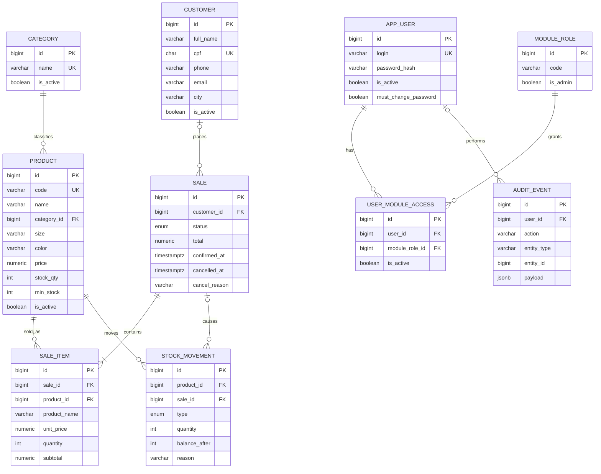

## 3. Modelo de dados

São 12 tabelas: 6 do núcleo (acesso e auditoria) e 6 do módulo `crm`. Nomes em inglês e `snake_case`; na tela tudo aparece em português. Nenhuma venda, produto ou cliente é apagado: o histórico fica, e `stock_movement` e `audit_event` são imutáveis por trigger.



`REFRESH_TOKEN` e `MODULE` ficam fora do diagrama por clareza; estão no script.

### Convenções do banco

| Regra | Como fica |
| --- | --- |
| Chave primária | `bigint GENERATED ALWAYS AS IDENTITY`, nunca UUID |
| Ativo/inativo | `is_active boolean`, nunca status textual nem soft-delete |
| Datas | `timestamptz`, `created_at` e `updated_at` em toda tabela de cadastro |
| Autoria | `created_by` / `updated_by` → `app_user`, `ON DELETE SET NULL` |
| Enum de domínio | Tipo `ENUM` do Postgres com nome explícito (`sale_status`, `stock_movement_type`) |
| Chaves estrangeiras | `RESTRICT` para catálogo e histórico; `CASCADE` só em `refresh_token` (sessão não é histórico) |
| Coerência | `CHECK` nomeado no banco, além da validação no Service |
| Nomes de constraint | `pk_`, `fk_`, `ux_`, `ix_`, `ck_` + tabela + campo |
| Valor da época | `sale_item` copia `product_code`, `product_name` e `unit_price` |

### Dicionário do módulo crm

| Tabela | Campo | Regra |
| --- | --- | --- |
| customer | full\_name | Obrigatório, mínimo 3 caracteres |
| customer | cpf | Único, 11 dígitos, dígito verificador validado no Service |
| customer | phone | 10 ou 11 dígitos |
| customer | email | Obrigatório, formato validado no Service |
| customer | zip\_code, street, number, district, city, state | Obrigatórios; `complement` opcional |
| category | name | Único sem diferenciar maiúsculas (índice em `lower(name)`) |
| product | code | Único (ex.: `CAM-001-P-PT`) |
| product | category\_id | Obrigatório, categoria ativa |
| product | price | `> 0` |
| product | stock\_qty | `>= 0`; muda só junto com uma `stock_movement` |
| product | min\_stock | `>= 0`, padrão 5; define "estoque baixo" |
| sale | customer\_id | Opcional (venda sem cliente identificado) |
| sale | status | `DRAFT` (tela: Aberta), `CONFIRMED` (Confirmada), `CANCELLED` (Cancelada) |
| sale | total | Recalculado no servidor a cada item |
| sale\_item | product\_code, product\_name, unit\_price | Copiados do produto ao incluir o item |
| sale\_item | subtotal | `= unit_price × quantity` (CHECK) |
| stock\_movement | type | `ENTRY`, `ADJUSTMENT`, `SALE`, `SALE_CANCELLATION` |
| stock\_movement | quantity | Com sinal e coerente com o tipo (CHECK) |
| stock\_movement | balance\_after | Saldo do produto logo depois |
| stock\_movement | (sale\_id, product\_id, type) | Único: o banco impede baixa ou estorno duplicado |
| sales\_target | (seller\_id, period\_month) | Único: uma meta por vendedor e mês (V6, spec crm/06) |
| sales\_target | period\_month | Sempre o dia 1 do mês (CHECK) |
| stock\_request | status | `OPEN`, `RESOLVED`, `CANCELLED`; fechado exige `closed_at` e `closing_note` (CHECK) (V8, spec crm/09) |
| stock\_request | product\_id, customer\_id | Opcionais; RESTRICT |
| purchase\_order | status | `OPEN`, `RECEIVED`, `CANCELLED`; fechado exige `closed_at`; cancelado exige `closing_note` (CHECK) (V10, spec crm/11) |
| purchase\_order | expected\_date, reschedule\_count | Data prometida; quantas vezes mudou (as datas antigas ficam em `audit_event`) |
| purchase\_order | status (V11) | `OPEN`, `IN_TRANSIT`, `CHECKING`, `RECEIVED`, `CANCELLED`; em trânsito exige `shipped_at`, em conferência exige `arrived_at` (`ck_purchase_order_steps`); `invoice_number` = nº da nota fiscal |
| purchase\_order | bonus\_invoice\_number, return\_count (V12) | Nota de bonificação do que veio a mais; quantas vezes a nota voltou |
| purchase\_order\_item | received\_quantity (V12) | Contado na conferência; nulo até a entrada |
| purchase\_order\_item | (order\_id, product\_id) | Único: uma linha por peça no pedido; `quantity` de 1 a 9999 (CHECK); RESTRICT |
| sale | channel | `STORE` (balcão, padrão) ou `ONLINE` (espaço do cliente) (V9) |
| customer | user\_id | Conta de acesso do cliente; única; opcional (V9) |
| payment | sale\_id | Um pagamento por pedido (único); `method` PIX/CARD; `card_last4` só no cartão; `status` APPROVED/REFUNDED (V9) |
| sales\_target | amount | `> 0` (CHECK); mudança vai para `audit_event` (`sales_target_set`, de → para) |

### Migrations Flyway (PostgreSQL 16)

Uma migration por grupo coeso; núcleo e módulo nunca na mesma. Cada `V{n}` tem o reverso em `src/main/resources/db/undo/U{n}__*.sql`, aplicado à mão pelo runbook (o Flyway Community não roda undo).

```sql
-- V1__core_identity_rbac.sql
-- Núcleo: contas, sessões e permissões por módulo (padrão da Plataforma de Operações).
CREATE TABLE app_user (
  id                   bigint GENERATED ALWAYS AS IDENTITY,
  login                varchar(120) NOT NULL,
  full_name            varchar(120) NOT NULL,
  password_hash        varchar(255) NOT NULL,
  is_active            boolean      NOT NULL DEFAULT true,
  is_blocked           boolean      NOT NULL DEFAULT false,
  is_super_admin       boolean      NOT NULL DEFAULT false,
  must_change_password boolean      NOT NULL DEFAULT true,
  last_login_at        timestamptz,
  created_at           timestamptz  NOT NULL DEFAULT now(),
  updated_at           timestamptz  NOT NULL DEFAULT now(),
  CONSTRAINT pk_app_user PRIMARY KEY (id),
  CONSTRAINT ux_app_user_login UNIQUE (login),
  CONSTRAINT ck_app_user_blocked_inactive CHECK (NOT is_blocked OR NOT is_active)
);

CREATE TABLE refresh_token (
  id                   bigint GENERATED ALWAYS AS IDENTITY,
  user_id              bigint      NOT NULL,
  token_hash           char(64)    NOT NULL,   -- SHA-256 em hex; o token puro nunca é salvo
  session_started_at   timestamptz NOT NULL,
  expires_at           timestamptz NOT NULL,
  revoked_at           timestamptz,
  replaced_by_token_id bigint,
  ip                   inet,
  user_agent           varchar(300),
  created_at           timestamptz NOT NULL DEFAULT now(),
  CONSTRAINT pk_refresh_token PRIMARY KEY (id),
  CONSTRAINT ux_refresh_token_hash UNIQUE (token_hash),
  CONSTRAINT fk_refresh_token_user FOREIGN KEY (user_id) REFERENCES app_user(id) ON DELETE CASCADE,
  CONSTRAINT fk_refresh_token_replaced FOREIGN KEY (replaced_by_token_id) REFERENCES refresh_token(id) ON DELETE SET NULL
);
CREATE INDEX ix_refresh_token_session ON refresh_token (user_id, session_started_at);

CREATE TABLE module (
  id        bigint GENERATED ALWAYS AS IDENTITY,
  code      varchar(40)  NOT NULL,
  name      varchar(80)  NOT NULL,
  is_active boolean      NOT NULL DEFAULT true,
  CONSTRAINT pk_module PRIMARY KEY (id),
  CONSTRAINT ux_module_code UNIQUE (code)
);

CREATE TABLE module_role (
  id        bigint GENERATED ALWAYS AS IDENTITY,
  module_id bigint      NOT NULL,
  code      varchar(40) NOT NULL,
  name      varchar(80) NOT NULL,
  is_admin  boolean     NOT NULL DEFAULT false,
  CONSTRAINT pk_module_role PRIMARY KEY (id),
  CONSTRAINT ux_module_role_code UNIQUE (module_id, code),
  CONSTRAINT fk_module_role_module FOREIGN KEY (module_id) REFERENCES module(id) ON DELETE RESTRICT
);

CREATE TABLE user_module_access (
  id             bigint GENERATED ALWAYS AS IDENTITY,
  user_id        bigint      NOT NULL,
  module_id      bigint      NOT NULL,
  module_role_id bigint      NOT NULL,
  is_active      boolean     NOT NULL DEFAULT true,
  created_at     timestamptz NOT NULL DEFAULT now(),
  updated_at     timestamptz NOT NULL DEFAULT now(),
  CONSTRAINT pk_user_module_access PRIMARY KEY (id),
  CONSTRAINT ux_user_module_access UNIQUE (user_id, module_id),   -- um papel por módulo
  CONSTRAINT fk_uma_user   FOREIGN KEY (user_id)        REFERENCES app_user(id)    ON DELETE RESTRICT,
  CONSTRAINT fk_uma_module FOREIGN KEY (module_id)      REFERENCES module(id)      ON DELETE RESTRICT,
  CONSTRAINT fk_uma_role   FOREIGN KEY (module_role_id) REFERENCES module_role(id) ON DELETE RESTRICT
);
```

```sql
-- V2__core_audit.sql
-- Auditoria genérica e append-only: qualquer módulo grava sem mudar o schema do núcleo.
CREATE TABLE audit_event (
  id          bigint GENERATED ALWAYS AS IDENTITY,
  user_id     bigint,
  module_id   bigint,
  action      varchar(80) NOT NULL,   -- ex.: sale_confirmed, sale_cancelled, stock_adjusted
  entity_type varchar(60) NOT NULL,
  entity_id   bigint      NOT NULL,
  payload     jsonb,
  ip          inet,
  user_agent  varchar(300),
  created_at  timestamptz NOT NULL DEFAULT now(),
  CONSTRAINT pk_audit_event PRIMARY KEY (id),
  CONSTRAINT fk_audit_user   FOREIGN KEY (user_id)   REFERENCES app_user(id) ON DELETE SET NULL,
  CONSTRAINT fk_audit_module FOREIGN KEY (module_id) REFERENCES module(id)   ON DELETE SET NULL
);
CREATE INDEX ix_audit_entity ON audit_event (module_id, entity_type, entity_id, created_at);
CREATE INDEX ix_audit_user   ON audit_event (user_id, created_at);

-- Função reutilizada pelas tabelas imutáveis (audit_event aqui, stock_movement no V4).
CREATE OR REPLACE FUNCTION fn_reject_mutation() RETURNS trigger AS $$
BEGIN
  RAISE EXCEPTION '% é um registro permanente: as linhas não se alteram nem se apagam', TG_TABLE_NAME;
END; $$ LANGUAGE plpgsql;

CREATE TRIGGER trg_audit_event_immutable BEFORE UPDATE OR DELETE ON audit_event
  FOR EACH ROW EXECUTE FUNCTION fn_reject_mutation();
```

```sql
-- V3__crm_catalog.sql
-- Módulo crm: cadastros. Nenhuma FK em CASCADE: catálogo nunca apaga histórico.
CREATE TABLE customer (
  id          bigint GENERATED ALWAYS AS IDENTITY,
  full_name   varchar(120) NOT NULL,
  cpf         char(11)     NOT NULL,
  phone       varchar(11)  NOT NULL,
  email       varchar(120) NOT NULL,
  zip_code    char(8)      NOT NULL,
  street      varchar(120) NOT NULL,
  number      varchar(10)  NOT NULL,
  complement  varchar(60),
  district    varchar(60)  NOT NULL,
  city        varchar(60)  NOT NULL,
  state       char(2)      NOT NULL,
  is_active   boolean      NOT NULL DEFAULT true,
  created_by  bigint,
  updated_by  bigint,
  created_at  timestamptz  NOT NULL DEFAULT now(),
  updated_at  timestamptz  NOT NULL DEFAULT now(),
  CONSTRAINT pk_customer PRIMARY KEY (id),
  CONSTRAINT ux_customer_cpf UNIQUE (cpf),
  CONSTRAINT ck_customer_cpf_digits   CHECK (cpf ~ '^[0-9]{11}$'),
  CONSTRAINT ck_customer_phone_digits CHECK (phone ~ '^[0-9]{10,11}$'),
  CONSTRAINT ck_customer_zip_digits   CHECK (zip_code ~ '^[0-9]{8}$'),
  CONSTRAINT ck_customer_name_len     CHECK (char_length(btrim(full_name)) >= 3),
  CONSTRAINT fk_customer_created_by FOREIGN KEY (created_by) REFERENCES app_user(id) ON DELETE SET NULL,
  CONSTRAINT fk_customer_updated_by FOREIGN KEY (updated_by) REFERENCES app_user(id) ON DELETE SET NULL
);
CREATE INDEX ix_customer_name ON customer (lower(full_name));

CREATE TABLE category (
  id          bigint GENERATED ALWAYS AS IDENTITY,
  name        varchar(60)  NOT NULL,
  description varchar(255),
  is_active   boolean      NOT NULL DEFAULT true,
  created_at  timestamptz  NOT NULL DEFAULT now(),
  updated_at  timestamptz  NOT NULL DEFAULT now(),
  CONSTRAINT pk_category PRIMARY KEY (id)
);
CREATE UNIQUE INDEX ux_category_name_ci ON category (lower(name));

CREATE TABLE product (
  id          bigint GENERATED ALWAYS AS IDENTITY,
  code        varchar(30)   NOT NULL,
  name        varchar(120)  NOT NULL,
  description varchar(500),
  category_id bigint        NOT NULL,
  size        varchar(10)   NOT NULL,
  color       varchar(30)   NOT NULL,
  price       numeric(12,2) NOT NULL,
  stock_qty   integer       NOT NULL DEFAULT 0,
  min_stock   integer       NOT NULL DEFAULT 5,
  is_active   boolean       NOT NULL DEFAULT true,
  created_by  bigint,
  updated_by  bigint,
  created_at  timestamptz   NOT NULL DEFAULT now(),
  updated_at  timestamptz   NOT NULL DEFAULT now(),
  CONSTRAINT pk_product PRIMARY KEY (id),
  CONSTRAINT ux_product_code UNIQUE (code),
  CONSTRAINT ck_product_price     CHECK (price > 0),
  CONSTRAINT ck_product_stock     CHECK (stock_qty >= 0),
  CONSTRAINT ck_product_min_stock CHECK (min_stock >= 0),
  CONSTRAINT fk_product_category   FOREIGN KEY (category_id) REFERENCES category(id) ON DELETE RESTRICT,
  CONSTRAINT fk_product_created_by FOREIGN KEY (created_by)  REFERENCES app_user(id) ON DELETE SET NULL,
  CONSTRAINT fk_product_updated_by FOREIGN KEY (updated_by)  REFERENCES app_user(id) ON DELETE SET NULL
);
CREATE INDEX ix_product_name     ON product (lower(name));
CREATE INDEX ix_product_category ON product (category_id);
```

```sql
-- V4__crm_sales_stock.sql
-- Vendas e movimentação de estoque. A venda nunca é apagada: cancela-se com motivo.
CREATE TYPE sale_status AS ENUM ('DRAFT', 'CONFIRMED', 'CANCELLED');
CREATE TYPE stock_movement_type AS ENUM ('ENTRY', 'ADJUSTMENT', 'SALE', 'SALE_CANCELLATION');

CREATE TABLE sale (
  id            bigint GENERATED ALWAYS AS IDENTITY,
  customer_id   bigint,
  status        sale_status   NOT NULL DEFAULT 'DRAFT',
  total         numeric(12,2) NOT NULL DEFAULT 0,
  confirmed_at  timestamptz,
  cancelled_at  timestamptz,
  cancel_reason varchar(255),
  created_by    bigint,
  cancelled_by  bigint,
  created_at    timestamptz NOT NULL DEFAULT now(),
  updated_at    timestamptz NOT NULL DEFAULT now(),
  CONSTRAINT pk_sale PRIMARY KEY (id),
  CONSTRAINT ck_sale_total     CHECK (total >= 0),
  CONSTRAINT ck_sale_confirmed CHECK (status <> 'CONFIRMED' OR confirmed_at IS NOT NULL),
  CONSTRAINT ck_sale_cancelled CHECK ((status = 'CANCELLED') = (cancelled_at IS NOT NULL AND cancel_reason IS NOT NULL)),
  CONSTRAINT fk_sale_customer     FOREIGN KEY (customer_id)  REFERENCES customer(id) ON DELETE RESTRICT,
  CONSTRAINT fk_sale_created_by   FOREIGN KEY (created_by)   REFERENCES app_user(id) ON DELETE SET NULL,
  CONSTRAINT fk_sale_cancelled_by FOREIGN KEY (cancelled_by) REFERENCES app_user(id) ON DELETE SET NULL
);
CREATE INDEX ix_sale_status_confirmed ON sale (status, confirmed_at);
CREATE INDEX ix_sale_customer         ON sale (customer_id, created_at);

CREATE TABLE sale_item (
  id           bigint GENERATED ALWAYS AS IDENTITY,
  sale_id      bigint        NOT NULL,
  product_id   bigint        NOT NULL,
  product_code varchar(30)   NOT NULL,   -- copiado: preserva a venda se o produto mudar
  product_name varchar(120)  NOT NULL,
  unit_price   numeric(12,2) NOT NULL,
  quantity     integer       NOT NULL,
  subtotal     numeric(12,2) NOT NULL,
  CONSTRAINT pk_sale_item PRIMARY KEY (id),
  CONSTRAINT ux_sale_item_product UNIQUE (sale_id, product_id),
  CONSTRAINT ck_sale_item_qty      CHECK (quantity > 0),
  CONSTRAINT ck_sale_item_price    CHECK (unit_price > 0),
  CONSTRAINT ck_sale_item_subtotal CHECK (subtotal = unit_price * quantity),
  CONSTRAINT fk_sale_item_sale    FOREIGN KEY (sale_id)    REFERENCES sale(id)    ON DELETE RESTRICT,
  CONSTRAINT fk_sale_item_product FOREIGN KEY (product_id) REFERENCES product(id) ON DELETE RESTRICT
);

CREATE TABLE stock_movement (
  id            bigint GENERATED ALWAYS AS IDENTITY,
  product_id    bigint              NOT NULL,
  sale_id       bigint,
  type          stock_movement_type NOT NULL,
  quantity      integer             NOT NULL,
  balance_after integer             NOT NULL,
  reason        varchar(255),
  created_by    bigint,
  created_at    timestamptz         NOT NULL DEFAULT now(),
  CONSTRAINT pk_stock_movement PRIMARY KEY (id),
  CONSTRAINT ck_stock_movement_qty     CHECK (quantity <> 0),
  CONSTRAINT ck_stock_movement_balance CHECK (balance_after >= 0),
  CONSTRAINT ck_stock_movement_sign CHECK (
       (type = 'ENTRY'             AND quantity > 0)
    OR (type = 'SALE'              AND quantity < 0)
    OR (type = 'SALE_CANCELLATION' AND quantity > 0)
    OR  type = 'ADJUSTMENT'),
  CONSTRAINT ck_stock_movement_sale   CHECK ((type IN ('SALE', 'SALE_CANCELLATION')) = (sale_id IS NOT NULL)),
  CONSTRAINT ck_stock_movement_reason CHECK (type <> 'ADJUSTMENT' OR reason IS NOT NULL),
  -- Uma baixa e um estorno por item, no máximo: segunda confirmação ou cancelamento falha no banco.
  CONSTRAINT ux_stock_movement_sale_item UNIQUE (sale_id, product_id, type),
  CONSTRAINT fk_stock_movement_product    FOREIGN KEY (product_id) REFERENCES product(id)  ON DELETE RESTRICT,
  CONSTRAINT fk_stock_movement_sale       FOREIGN KEY (sale_id)    REFERENCES sale(id)     ON DELETE RESTRICT,
  CONSTRAINT fk_stock_movement_created_by FOREIGN KEY (created_by) REFERENCES app_user(id) ON DELETE SET NULL
);
CREATE INDEX ix_stock_movement_product ON stock_movement (product_id, created_at);

CREATE TRIGGER trg_stock_movement_immutable BEFORE UPDATE OR DELETE ON stock_movement
  FOR EACH ROW EXECUTE FUNCTION fn_reject_mutation();
```

No Java, os enums mapeiam com `@Enumerated(EnumType.STRING)` + `@JdbcType(PostgreSQLEnumJdbcType.class)`. Módulo e papéis **não** entram em migration: são dados do `CrmModuleSeeder` (seção 9).
